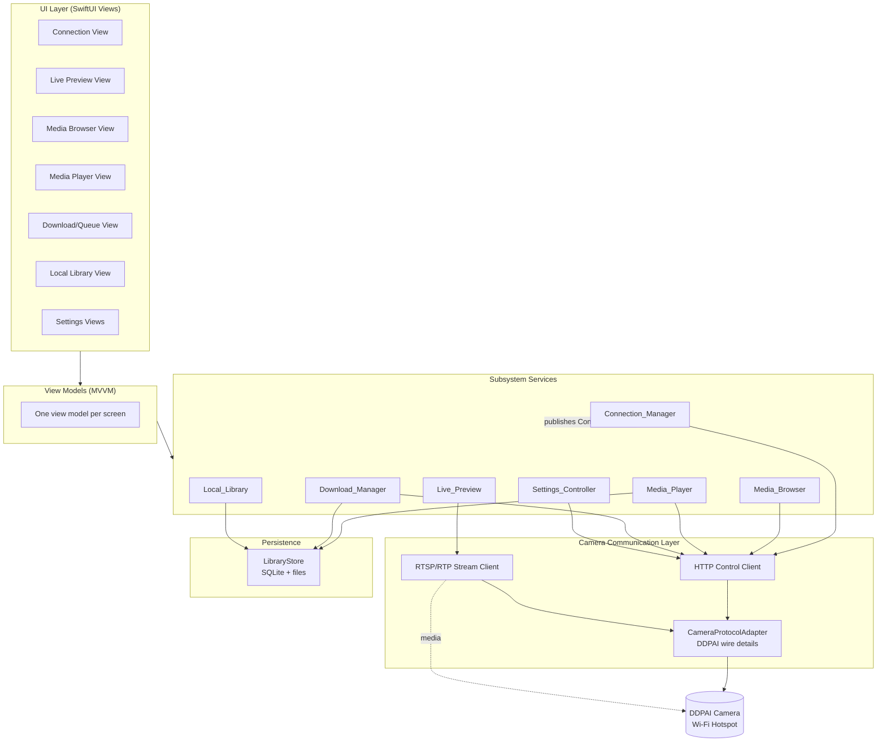
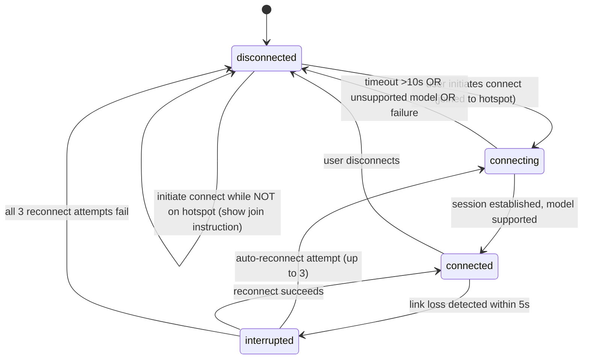
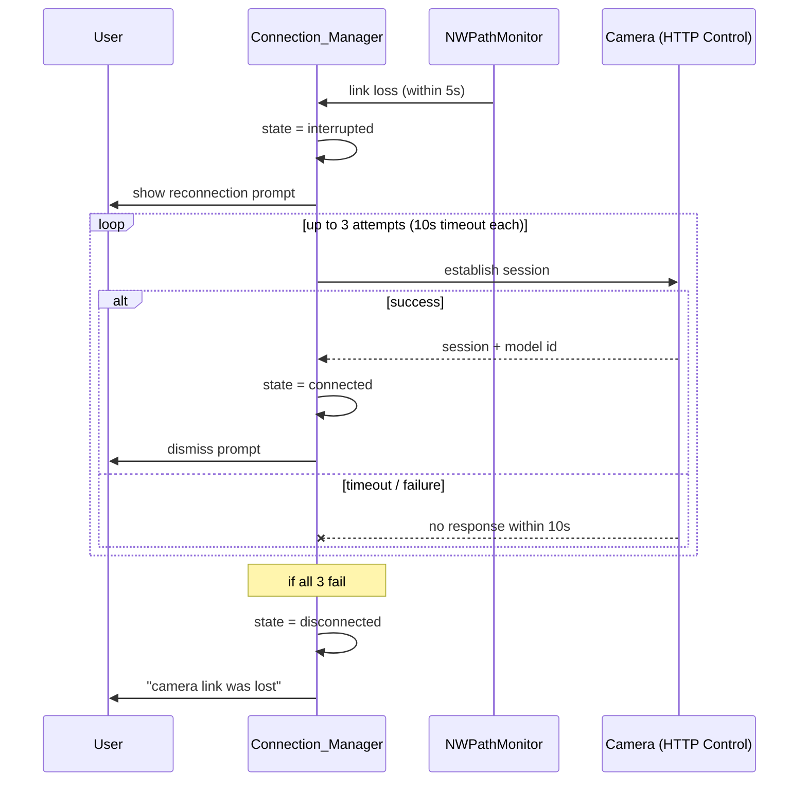
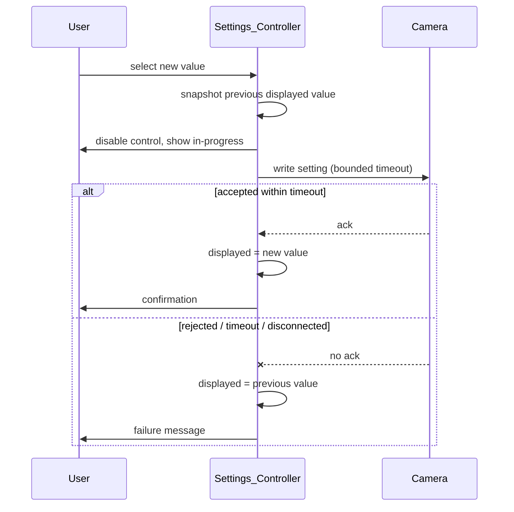

# Design Document

## Overview

This document describes the design of the DDPAI dash cam companion app for iOS. The app is a native iOS application that connects to a DDPAI dash camera over the camera's own Wi-Fi hotspot and provides three capability groups described in the requirements: live preview, playback and download of recorded footage, and remote control of camera settings.

### Camera Communication Model

DDPAI cameras (and comparable Wi-Fi dash cams) operate as a self-hosted access point. The phone joins the camera's Wi-Fi_Hotspot, then communicates with the camera on a fixed gateway address over two channels:

- **Control / data channel** — an HTTP request/response API hosted by the camera. Used for session establishment, model identification, clip enumeration, lock/unlock, settings read/write, and clip file download (ranged HTTP GET).
- **Media channel** — a real-time streaming session for Live_Preview. This is modeled as an RTSP-style control session (DESCRIBE / SETUP / PLAY / PAUSE / TEARDOWN) carrying H.264 video and optional audio over RTP. Recorded-clip playback streams the clip file over the control channel's HTTP endpoint (progressive/ranged GET) and is played with the platform media stack.

Research note: public DDPAI material confirms the Wi-Fi direct-connection model where the phone controls the camera, views video, and downloads footage over the camera's local network ([DDPAI: Dash Cam Wi-Fi and Bluetooth Connectivity](https://www.ddpai.com/blog/dash-cam-wi-fi-and-bluetooth-connectivity/)). RTSP is a control protocol issuing PLAY/PAUSE/TEARDOWN while media travels over a transport such as RTP ([RFC 2326 / RTSP overview](https://antmedia.io/rtsp-explained-what-is-rtsp-how-it-works/)). The exact DDPAI endpoint paths are vendor-specific and are isolated behind a protocol adapter (see Camera Communication Layer) so they can be adjusted per camera model without touching application logic. _Content was rephrased for compliance with licensing restrictions._

### Design Goals

- Keep all camera-specific wire details (endpoint paths, parameter names, stream URLs) isolated in one adapter layer so the rest of the app depends only on protocol-neutral abstractions.
- Make Connection_State the single source of truth that every subsystem observes, so screens react uniformly to connect/interrupt/disconnect transitions.
- Keep pure, testable logic (filtering, ordering, state transitions, storage math, duration/size formatting, resume math) free of I/O so it can be validated with property-based tests.
- Ensure the Local_Library works fully offline.

### Technology Stack

| Concern | Choice | Rationale |
|---|---|---|
| Language | Swift 5.9+ | Native iOS, first-class concurrency (async/await, actors) |
| UI | SwiftUI | Declarative, state-driven UI matches Connection_State observation model |
| Architecture pattern | MVVM + unidirectional state | View models expose observable state; views are a function of state |
| Concurrency | Swift Concurrency (async/await, actors, `AsyncStream`) | Structured timeouts and cancellation map directly to the requirement timeouts |
| HTTP | `URLSession` | Native, supports ranged GET and background-eligible transfers for download |
| Live video | `AVFoundation` + an RTSP/RTP client component | Decode and render H.264; RTSP session control for PLAY/PAUSE/TEARDOWN |
| Clip playback | `AVPlayer` | Streams camera clip URLs and local file URLs uniformly |
| Local persistence | SQLite (via GRDB) for metadata + app-container files for media | Queryable clip metadata; large media kept as files |
| Reachability | `NWPathMonitor` (Network framework) | Detect loss of the camera link |

## Architecture

The app is layered. The top layer is SwiftUI views; each feature screen is backed by a view model. View models depend on subsystem services (the glossary subsystems). All camera I/O funnels through the Camera Communication Layer, which depends on a single `CameraProtocolAdapter` that encapsulates DDPAI-specific wire details. Local persistence is reached through a `LibraryStore`.



### Connection State as Shared Observable

`Connection_Manager` owns a single observable `Connection_State`. Every subsystem subscribes to it rather than probing the link independently. This makes requirements such as 2.4 (Live_Preview stops on interrupt), 3.10 (browser stops retrieval on disconnect), 5.5 (download marks incomplete on interrupt), and 9.5 (pending settings change canceled on disconnect) all consume the same signal.



### Reconnection Flow



## Components and Interfaces

Interfaces are expressed as protocol-neutral Swift signatures. Camera-specific encoding lives only in `CameraProtocolAdapter`.

### Camera Communication Layer

```swift
// Encapsulates all DDPAI-specific wire details. The only type that knows
// endpoint paths, parameter names, and stream URL formats.
protocol CameraProtocolAdapter {
    func sessionRequest() -> HTTPRequest
    func parseSession(_ response: HTTPResponse) throws -> CameraSession   // includes model id
    func clipListRequest() -> HTTPRequest
    func parseClipList(_ response: HTTPResponse) throws -> [ClipMetadata]
    func clipDownloadRequest(clipID: ClipID, fromByte: Int64) -> HTTPRequest  // ranged GET
    func clipPlaybackURL(clipID: ClipID) -> URL
    func liveStreamURL() -> URL                                           // RTSP URL
    func lockRequest(clipID: ClipID, locked: Bool) -> HTTPRequest
    func settingsReadRequest(_ key: SettingKey) -> HTTPRequest
    func settingsWriteRequest(_ key: SettingKey, value: SettingValue) -> HTTPRequest
    func parseSetting(_ key: SettingKey, _ response: HTTPResponse) throws -> SettingValue
    var supportedModels: Set<String> { get }
}

protocol HTTPControlClient {
    // All calls carry a timeout; callers pass the requirement-specific bound.
    func send(_ request: HTTPRequest, timeout: Duration) async throws -> HTTPResponse
    // Ranged, resumable download producing progress updates.
    func download(_ request: HTTPRequest, to fileURL: URL,
                  resumingFrom byte: Int64) -> AsyncThrowingStream<DownloadProgress, Error>
}

protocol LiveStreamClient {
    func start(url: URL) async throws -> LiveStreamHandle   // DESCRIBE/SETUP/PLAY
    func stop(_ handle: LiveStreamHandle) async             // TEARDOWN
    var frames: AsyncStream<DecodedFrame> { get }
    var audioAvailable: Bool { get }
    func setAudioMuted(_ muted: Bool)
}
```

### Connection_Manager

```swift
@MainActor
protocol ConnectionManaging: AnyObject {
    var state: Published<ConnectionState>.Publisher { get }
    var cameraModel: String? { get }
    func connect() async               // honors 10s timeout, model check (R1.2–1.6)
    func disconnect() async
    // Internal: monitors link, triggers interrupted + auto-reconnect (R1.7–1.9)
}
```

Responsibilities: expose `Connection_State` (R1.1); require hotspot join before connecting (R1.4); enforce the 10s connect timeout (R1.2, R1.5); validate the model against `supportedModels` (R1.6); detect link loss within 5s (R1.7); run up to 3 auto-reconnect attempts at 10s each (R1.8); fall back to disconnected on exhaustion (R1.9).

### Live_Preview

```swift
@MainActor
protocol LivePreviewing: AnyObject {
    var status: LivePreviewStatus { get }  // idle, starting, rendering(resolution,signal), unavailable
    func open() async      // first frame within 5s or unavailable + retry (R2.2, R2.7)
    func close() async     // stop requesting stream on leave (R2.5)
    func setAudioMuted(_ muted: Bool)      // only when audioAvailable (R2.6)
    func retry() async
}
```

Observes Connection_State: on interrupted/disconnected it stops rendering within 2s and shows a stream-unavailable message (R2.4). While rendering it surfaces resolution and a signal indicator (R2.3).

### Media_Browser

```swift
@MainActor
protocol MediaBrowsing: AnyObject {
    var clips: [ClipRow] { get }        // sorted, filtered, with downloaded + protected flags
    var loadState: BrowserLoadState { get }  // loading, loaded, empty, failed, connectionLost
    func load() async                    // 15s timeout (R3.1, R3.9)
    func setFilter(_ filter: ClipFilter) // all / normal / event / emergency (R3.5, R3.6, R6.2)
    func retry() async
}
```

The browser retrieves raw metadata via the HTTP client, then applies pure functions for ordering (R3.7) and filtering (R3.5, R3.6, R6.2). Downloaded and protected flags are joined from `LibraryStore` and clip metadata respectively.

### Media_Player

```swift
@MainActor
protocol MediaPlaying: AnyObject {
    var position: Duration { get }
    var duration: Duration { get }
    var playbackState: PlaybackState { get }  // playing, paused, failed, unavailable
    func play(_ clip: ClipID) async      // local if present, else stream (R4.6, R4.1, R4.4, R4.7)
    func pause(); func seek(to: Duration) // 0...duration (R4.2)
    func retry() async
}
```

Source selection is a pure decision: if the clip exists in Local_Library, play the local file (R4.6); else if connected, stream from the camera; else report unavailable (R4.7).

### Download_Manager

```swift
actor DownloadManager {
    func enqueue(_ clips: [ClipID]) throws   // max 100, preserves selection order (R5.4)
    func cancel(_ clip: ClipID) async        // stop within 2s, remove partial (R5.9)
    func resume(_ clip: ClipID) async        // from retained byte count if connected (R5.6, R5.7)
    var progress: AsyncStream<DownloadQueueState> { get }  // integer % <=1s cadence (R5.2)
}
```

Processes the queue sequentially (R5.4). Before each download it checks storage against clip size + 50 MB reserve (R5.8). On interrupt it marks the download incomplete and retains the completed byte count (R5.5). On completion it stores the clip and marks it downloaded (R5.3), carrying the protected flag for Emergency_Footage (R6.8).

### Local_Library

```swift
protocol LocalLibrary {
    func allClips() async -> [StoredClip]    // sorted desc by start timestamp (R7.2)
    func contains(_ clip: ClipID) async -> Bool
    func delete(_ clip: ClipID) async throws  // on failure retain + message (R7.4, R7.5)
    func fileURL(for clip: ClipID) -> URL?
    // share + photo-library export handled at the view layer via iOS share/Photos APIs (R7.6–7.8)
}
```

Available regardless of Connection_State (R7.1, R7.3).

### Settings_Controller

```swift
@MainActor
protocol SettingsControlling: AnyObject {
    func syncAll() async                       // on connect: loading -> values (R12.1, R12.2)
    func readSetting(_ key: SettingKey) async -> SettingState
    func writeSetting(_ key: SettingKey, _ value: SettingValue) async -> WriteOutcome
    func lock(_ clip: ClipID, locked: Bool) async -> WriteOutcome  // R6.4–6.7
}
```

Handles resolution (R8), collision sensitivity (R9), audio toggle (R10), parking monitoring (R11), and the synchronization/revert rules (R12). Each write uses an optimistic-with-revert pattern: show in-progress, disable the control while pending, and on rejection/timeout/disconnect revert to the previously displayed value and show a failure message (R8.4, R9.4, R9.5, R10.4, R10.5, R11.3, R11.6, R12.4).

### Settings Write Flow



## Data Models

```swift
enum ConnectionState: Equatable { case disconnected, connecting, connected, interrupted }

enum ClipType: Equatable { case normal, event }

typealias ClipID = String

struct ClipMetadata: Equatable {
    let id: ClipID
    let startTimestamp: Date      // recording start
    let duration: Duration        // used for H:M:S display (R3.3)
    let sizeBytes: Int64          // used for MB display (R3.3)
    let type: ClipType            // normal vs event (R3.4)
    let isLocked: Bool            // manual overwrite protection
    // Emergency_Footage == (type == .event) || isLocked   (R6.2)
    var isProtected: Bool { type == .event || isLocked }
}

struct StoredClip: Equatable {    // Local_Library entry
    let metadata: ClipMetadata
    let fileURL: URL
    let isProtected: Bool         // persisted protected flag (R6.8)
    let downloadedAt: Date
}

enum ClipFilter: Equatable { case all, normal, event, emergency }

enum DownloadStatus: Equatable {
    case queued
    case inProgress(percent: Int)         // 0...100 (R5.2)
    case interrupted(completedBytes: Int64) // retained for resume (R5.5)
    case completed
    case canceled
    case failedInsufficientStorage(required: Int64, available: Int64) // R5.8
}

struct DownloadTask: Equatable {
    let clip: ClipMetadata
    var status: DownloadStatus
    var completedBytes: Int64
    let selectionIndex: Int               // preserves selection order (R5.4)
}

enum SettingKey: Equatable {
    case resolution, collisionSensitivity, audioRecording
    case parkingMode, parkingSensitivity
}

enum SettingValue: Equatable {
    case resolution(String)
    case level(Int)                       // collision / parking sensitivity
    case bool(Bool)                       // audio recording
    case parkingMode(String)
}

struct SettingState: Equatable {
    let key: SettingKey
    let currentValue: SettingValue?       // Camera-reported current value
    let options: [SettingValue]           // supported options / range endpoints
    let availability: SettingAvailability // enabled, disabledConnectionRequired, retrievalFailed, pending
}

enum WriteOutcome: Equatable { case accepted(SettingValue); case rejected; case timedOut; case connectionLost }
```

### Persistence Schema (SQLite via GRDB)

| Table | Key columns | Purpose |
|---|---|---|
| `stored_clip` | `id` (PK), `start_timestamp`, `duration_ms`, `size_bytes`, `type`, `is_protected`, `file_relative_path`, `downloaded_at` | Local_Library metadata; queryable sort/filter offline |
| `download_task` | `clip_id` (PK), `status`, `completed_bytes`, `selection_index` | Resumable download bookkeeping across launches |

Media files are stored in the app container (`Application Support/clips/<id>.mp4`); only relative paths are persisted so the records survive container path changes.

## Correctness Properties

_A property is a characteristic or behavior that should hold true across all valid executions of a system — essentially, a formal statement about what the system should do. Properties serve as the bridge between human-readable specifications and machine-verifiable correctness guarantees._

These properties were derived from the acceptance criteria. Timing-bound criteria (connection timeouts, latency, first-frame-within-5s) and infrastructure/UI concerns are validated with integration and example tests in the Testing Strategy rather than as properties, because their behavior does not vary meaningfully with generated inputs. Redundant criteria were consolidated (for example, the three descending-order criteria collapse into one ordering property, and the many revert-on-failure criteria collapse into one write-revert property).

### Property 1: Camera model support decision

_For any_ model identifier returned during session establishment, the Connection_Manager treats the session as supported (reaching connected) if and only if the identifier is a member of the adapter's supported-models set; any non-member results in the unsupported outcome (disconnected).

**Validates: Requirements 1.6**

### Property 2: Bounded retry stops at the limit and on first success

_For any_ sequence of attempt outcomes with a maximum attempt count of 3, the retry loop performs at most 3 attempts, stops immediately on the first successful attempt, and ends in the success outcome if and only if some attempt within the first 3 succeeded; otherwise it ends in the failure/disconnected outcome.

**Validates: Requirements 1.8, 1.9, 12.2**

### Property 3: Live preview renders only while connected

_For any_ Connection_State value, the Live_Preview is in a rendering state only if the Connection_State is connected; equivalently, any interrupted or disconnected state implies the preview is not rendering.

**Validates: Requirements 2.4**

### Property 4: Clips are ordered by recording start timestamp descending

_For any_ collection of clips (camera-sourced or Local_Library), the displayed order is non-increasing by recording start timestamp — every clip's start timestamp is greater than or equal to the next clip's.

**Validates: Requirements 3.7, 3.5, 7.2**

### Property 5: Clip filtering is sound, complete, and order-preserving

_For any_ clip collection and any ClipFilter, the filtered result contains exactly those clips matching the filter (normal → type normal; event → type event; emergency → protected clips where type is event or the clip is locked; all → every clip), contains no clip that does not match, omits no clip that does match, and preserves descending start-timestamp order.

**Validates: Requirements 3.5, 3.6, 6.2**

### Property 6: Clip indicators reflect type and protection

_For any_ clip, the type indicator shows the event marker if and only if the clip type is event, and the protection indicator shows the protected marker if and only if the clip is protected (event or locked); the protected and unprotected markers are observably distinct.

**Validates: Requirements 3.4, 6.1**

### Property 7: Duration formatting round-trips and size formatting is consistent

_For any_ non-negative duration, formatting it to hours:minutes:seconds and parsing that string back yields the same whole-second count; and _for any_ non-negative byte size, the megabyte value equals the byte size divided by 1,048,576 under a fixed rounding rule and is never negative.

**Validates: Requirements 3.3, 4.3**

### Property 8: Values are clamped to their supported range

_For any_ range `[min, max]` with `min <= max` and any requested value (including values below min or above max), the effective value equals the request clamped into `[min, max]` — never below min, never above max, and equal to the request when it already lies within the range. This governs playback seek (range `0...duration`) and parking sensitivity.

**Validates: Requirements 4.2, 11.4**

### Property 9: Playback source selection

_For any_ clip and any Connection_State, the selected playback source is the Local_Library copy if the clip exists locally; otherwise it is the camera stream if the Connection_State is connected; otherwise the clip is reported unavailable. Local presence takes precedence over connection state.

**Validates: Requirements 4.6, 4.7**

### Property 10: Download progress percent is bounded and monotonic

_For any_ completed byte count and total byte count with `0 <= completed <= total` and `total > 0`, the reported progress is an integer in `0...100`, is non-decreasing as the completed count increases, and equals 100 if and only if `completed == total`.

**Validates: Requirements 5.2**

### Property 11: Download queue preserves selection order within the cap

_For any_ selection of clips, enqueuing produces a processing order identical to the selection order, and a selection exceeding 100 clips is constrained to the 100-clip maximum while still preserving the relative order of the retained clips.

**Validates: Requirements 5.4**

### Property 12: Interruption retains the completed byte count

_For any_ in-progress download that has transferred N bytes, an interruption transitions the task to the interrupted status with its retained completed-byte count equal to N, leaving N unchanged.

**Validates: Requirements 5.5**

### Property 13: Resume continues from the retained offset only when connected

_For any_ interrupted download with N completed bytes of T total: if the Connection_State is connected, resuming issues a transfer request starting at offset N and the remaining bytes satisfy `N + remaining == T`; if the Connection_State is not connected, the task stays interrupted with its completed-byte count unchanged and no transfer request is issued.

**Validates: Requirements 5.6, 5.7**

### Property 14: Storage sufficiency honors the reserve margin

_For any_ available-storage amount and requested clip size, the download proceeds if and only if `available >= clipSize + (50 * 1024 * 1024)`; when it does not proceed, the download is canceled, previously stored clips are retained, and the reported required and available amounts match the inputs.

**Validates: Requirements 5.8**

### Property 15: Lock then unlock is a protection round-trip

_For any_ clip, applying a confirmed lock followed by a confirmed unlock returns the clip's protection flag to its original value, and lock/unlock each set the flag to the requested state.

**Validates: Requirements 6.6**

### Property 16: Protection is preserved when a clip is stored

_For any_ clip downloaded to the Local_Library, the resulting stored clip's protected flag equals the source clip's protected status, so Emergency_Footage remains marked protected after download.

**Validates: Requirements 6.8**

### Property 17: Deleting a Local_Library clip removes only that clip

_For any_ Local_Library and any clip it contains, a successful delete results in a library that no longer contains that clip and still contains every other previously present clip.

**Validates: Requirements 7.4**

### Property 18: Settings control availability tracks connection state

_For any_ Connection_State, a settings control's availability is enabled if and only if the state is connected; any non-connected state yields a disabled control with a connection-required indication, and no write is issued while not connected.

**Validates: Requirements 8.5, 10.6, 11.7**

### Property 19: A pending write disables its control

_For any_ setting write, while the write is pending the control's availability is disabled, and it returns to enabled only after a terminal outcome (accepted, rejected, timed out, or connection lost) is observed.

**Validates: Requirements 8.6**

### Property 20: Writes apply on acceptance and revert on any non-acceptance

_For any_ setting (or clip lock) with a previously displayed value P and any write outcome: if the outcome is accepted with value V the displayed value becomes V; if the outcome is rejected, timed out, or connection-lost, the displayed value returns to P. The displayed value is never left on an unconfirmed optimistic value.

**Validates: Requirements 12.4, 8.4, 9.4, 9.5, 10.4, 10.5, 11.3, 11.6, 6.5, 6.7**

### Property 21: Display converges to the camera-reported value

_For any_ displayed setting value and any value reported by the camera, after reconciliation the displayed value equals the camera-reported value — the camera is the source of truth for settings.

**Validates: Requirements 12.3**

### Property 22: Audio recording toggle inverts and round-trips

_For any_ starting audio-recording state, a single confirmed toggle inverts the displayed state, and two consecutive confirmed toggles return the displayed state to its original value.

**Validates: Requirements 10.3**

## Error Handling

Errors are modeled as typed Swift errors surfaced through each subsystem's observable state, never as silent failures. Every camera interaction carries an explicit timeout bound taken from the governing requirement.

### Error Taxonomy

| Category | Source | Handling | Requirements |
|---|---|---|---|
| Not on hotspot | Connect initiated while iOS not joined to camera Wi-Fi | Remain disconnected; show join instruction | 1.4 |
| Connect timeout | No session within 10s | State → disconnected; connection-failure message | 1.5 |
| Unsupported model | Model id not in supported set | State → disconnected; unsupported-camera message | 1.6 |
| Link loss | Reachability drop while connected | State → interrupted; prompt; up to 3 auto-reconnects (10s each) | 1.7, 1.8 |
| Reconnect exhausted | All 3 reconnects fail | State → disconnected; link-lost message | 1.9 |
| Stream unavailable | No first frame in 5s, or state leaves connected | Stop rendering within 2s; stream-unavailable message + retry | 2.4, 2.7 |
| Clip list timeout | Retrieval exceeds 15s | Cancel; retrieval-failure message + retry | 3.9 |
| Clip list disconnect | State → disconnected mid-retrieval | Stop; connection-lost message + retry | 3.10 |
| Playback start timeout | Playback not started in 10s | Stop; playback-failure message + retry | 4.4 |
| Playback unavailable | Clip not local and not connected | Unavailable message | 4.7 |
| Download interrupted | State → interrupted/disconnected mid-transfer | Mark incomplete; retain completed bytes; status indication | 5.5 |
| Insufficient storage | available < clip size + 50 MB reserve | Cancel; retain stored clips; insufficient-storage message with required/available | 5.8 |
| Lock/unlock failure | Camera rejects or no response in 10s | Retain prior protection indicator; failure message | 6.5, 6.7 |
| Delete failure | Local file removal fails | Retain clip; deletion-failure message | 7.5 |
| Photo export without permission | Permission not granted | Direct user to grant permission | 7.8 |
| Settings retrieval failure | Options not returned / sync timeout / disconnect | Disable control or settings-unavailable message; retry (max 3 for sync) | 8.2, 12.2 |
| Settings write failure | Reject, timeout, or disconnect while pending | Revert displayed value to camera's current; failure message | 8.4, 9.4, 9.5, 10.4, 10.5, 11.3, 11.6, 12.4 |

### Cross-Cutting Rules

- **Single timeout mechanism.** All camera calls go through `HTTPControlClient.send(_:timeout:)`; the caller supplies the requirement's bound. Timeout and cancellation use Swift Concurrency task cancellation so a state change (e.g., disconnect) can cancel an in-flight call deterministically.
- **Optimistic-with-revert for all writes.** The displayed value is snapshotted before a write and restored on any non-accepted outcome (Property 20), so the UI never shows an unconfirmed value.
- **Connection_State is authoritative.** Subsystems react to a single observable; a disconnect cancels in-flight retrievals, pending writes, live streaming, and marks active downloads incomplete.
- **No partial state on cancel.** Canceling a download removes its partial file (R5.9); the metadata record is cleaned up transactionally with the file.

## Testing Strategy

The strategy is dual: property-based tests for universal input-varying logic, and example/integration tests for timing bounds, UI reactions, and I/O against the camera. Property-based tests keep pure logic in testable units isolated from I/O (the Camera Communication Layer and `LibraryStore` are protocols, mocked in tests).

### Property-Based Testing

- **Library:** [SwiftCheck](https://github.com/typelift/SwiftCheck) (or `swift-testing` with a generator layer) for property-based testing on the Swift/XCTest toolchain. Property-based testing is implemented using this library rather than hand-rolled generators.
- **Iterations:** each property test runs a minimum of 100 generated cases.
- **Tagging:** each property test is tagged with a comment of the form `Feature: ddpai-dashcam-ios, Property {number}: {property_text}` referencing the design property it implements.
- **One test per property:** each of Properties 1–22 is implemented by a single property-based test.
- **Targets of generation:** `ClipMetadata` lists (varying type, lock state, timestamps, sizes, durations), `ConnectionState` values, retry-outcome sequences, byte counts (completed/total), selection lists, ranges and requested values, setting values and write outcomes, and camera-reported values. Pure functions under test: ordering, filtering, indicator mapping, duration/size formatting, clamping, playback-source selection, progress computation, queue ordering, interrupt/resume math, storage-check predicate, protection round-trip, delete invariant, availability mapping, pending-disable logic, write apply/revert, convergence, and audio toggle.

The pure logic exercised by these properties is extracted into free functions / value types with no I/O so a property test can drive thousands of inputs cheaply.

### Example-Based Unit Testing

Focused tests for specific, non-input-varying behaviors and edge cases:

- State-label rendering for each Connection_State (R1.1), model-id display (R1.3), join instruction when not on hotspot (R1.4).
- Rendering-state exposes resolution and signal indicator (R2.3); teardown called on leaving preview (R2.5); mute control visibility gated on audio availability (R2.6).
- Loading indicator shown during retrieval (R3.2); empty-library message with zero rows (R3.8); no-matching-clips message (R3.6); no-emergency-footage message (R6.3).
- Retry re-invokes playback (R4.5).
- Download completion stores clip and sets downloaded flag (R5.3); cancel removes partial file (R5.9 cleanup).
- Local_Library offline display (R7.1), empty message (R7.3); delete-failure retains clip + message (R7.5); share sheet presentation (R7.6); photo-export permission granted path (R7.7) and denied message (R7.8).
- Settings in-progress indicator on selection (R9.2); audio retrieve/display and toggle issuing the requested write (R10.1, R10.2).

### Integration Testing

Against a mocked `CameraProtocolAdapter`/`HTTPControlClient`/`LiveStreamClient` (and, selectively, a reference camera on a real hotspot) to validate timing bounds and I/O wiring that properties cannot:

- Connect success within 10s and timeout → disconnected (R1.2, R1.3, R1.5); link-loss detection within 5s (R1.7); auto-reconnect timing (R1.8).
- Live preview first frame within 5s and latency within 2s (R2.1, R2.2); no-frame → unavailable + retry (R2.7).
- Clip list retrieval within 15s (R3.1), timeout (R3.9), and disconnect mid-retrieval (R3.10).
- Playback starts within 3s (R4.1) and start-timeout (R4.4).
- End-to-end download transfer and storage (R5.1); progress-update cadence ≤ 1s (R5.2 cadence); cancel stops within 2s (R5.9 timing).
- Lock/unlock confirm timing and update within 3s (R6.4, R6.6 timing); failure branches (R6.5, R6.7).
- Settings retrieval timing and failure (R8.1, R8.2, R12.1); accepted/rejected/timeout write paths across resolution, collision sensitivity, parking mode and sensitivity (R8.3, R8.4, R9.1–9.5, R11.1–11.6); settings sync with retry cap of 3 (R12.2); camera-report convergence timing (R12.3).

### Coverage Mapping

Every acceptance criterion maps to at least one test: input-varying criteria to a property (Properties 1–22), timing/I/O criteria to integration tests, and UI/edge criteria to example tests. Non-functional-only criteria without computable assertions (e.g., live latency feel) are covered by measured integration tests with representative streams.
